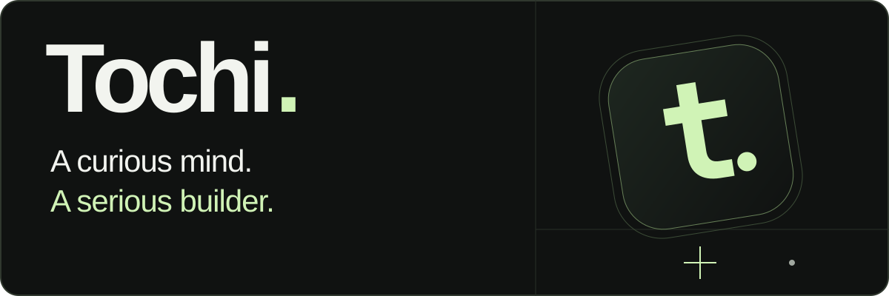

  

<strong>Frontend developer · Founder of Yunis · Biostatistics at UNILAG</strong>

  
  
  

## About

I'm **Tochi Okere**, a frontend developer based in Lagos, Nigeria, and a **Biostatistics student at the University of Lagos**. I work mainly with TypeScript, React, and Next.js, turning ideas into interfaces people can use.

I'm the founder of **Yunis** and the owner of **[Playbook Hub](https://selar.com/m/playbook-hub)**. Alongside client work and personal projects, I'm learning Node.js, Python, and Go to deepen my backend skills. Cybersecurity is a longer-term interest.

> I build seriously, experiment often, and sometimes ship a project just because I was bored — that's how **Awesome Generator** happened.

## Selected work

**Founder & builder · Private project · In development**

A platform focused on nurturing existing relationships, growing from my earlier Eternal Bond prototype. The foundation is implemented; the broader product is in development.

<table>
  <tr>
    <td width="50%" valign="top">
      
      <h3>Mouvelle</h3>
      
A client e-commerce storefront built with Next.js, React, and TypeScript.

      
<a href="https://mouvelle.vercel.app">Website ↗</a> · <a href="https://github.com/tochigit/Mouvelle-">Code</a>

    </td>
    <td width="50%" valign="top">
      
      <h3>Silent Rave</h3>
      
A university event website for a client, with event information and reservations.

      
<a href="https://silentrave.space">Website ↗</a> · <a href="https://github.com/tochigit/silent-rave">Code</a>

    </td>
  </tr>
  <tr>
    <td width="50%" valign="top">
      
      <h3>Pre-Order with Oma</h3>
      
A client pre-order storefront with a product catalog, cart, and WhatsApp ordering.

      
<a href="https://preorder-withoma-blush.vercel.app">Website ↗</a> · <a href="https://github.com/tochigit/Pre-Order-with-Oma">Code</a>

    </td>
    <td width="50%" valign="top">
      
      <h3>Awesome Prompt Generator</h3>
      
A Groq-powered tool that turns rough ideas into structured, model-agnostic prompts.

      
<a href="https://awesomegenerator.vercel.app">Try it ↗</a> · <a href="https://github.com/tochigit/Awesome-Generator">Code</a>

    </td>
  </tr>
</table>

More projects: [NudgeStack](https://github.com/tochigit/NudgeStack), a contact and reminder app; [YouTube Downloader](https://github.com/tochigit/youtube-downloader), a web utility; and [Occasio](https://github.com/tochigit/occaiso), an early event-planning project.

## Playbook Hub

I also own **[Playbook Hub](https://selar.com/m/playbook-hub)**, a digital store for practical guides and playbooks. It gives me another way to build products around what people want to learn and do.

**[Go to store ↗](https://selar.com/m/playbook-hub)**

## Toolkit

**Build with:** TypeScript · JavaScript · React · Next.js · HTML · CSS 
**Work with:** Git · GitHub · Vercel · VS Code · Claude Code · Codex 
**Integrations:** APIs · Groq 
**Currently learning:** Node.js · Python · Go

## Let's connect

For frontend opportunities, freelance work, or collaboration, email **[tochilink10@gmail.com](mailto:tochilink10@gmail.com)**.

[LinkedIn](https://www.linkedin.com/in/tochi-okere) · [GitHub](https://github.com/tochigit) · [Telegram](https://t.me/pr3ss_pl4y) 
**Discord:** `_call_me_legend_`

<strong>WhatsApp</strong> — choose a number

- [+234 708 354 0353](https://wa.me/2347083540353)
- [+234 916 617 7847](https://wa.me/2349166177847)

